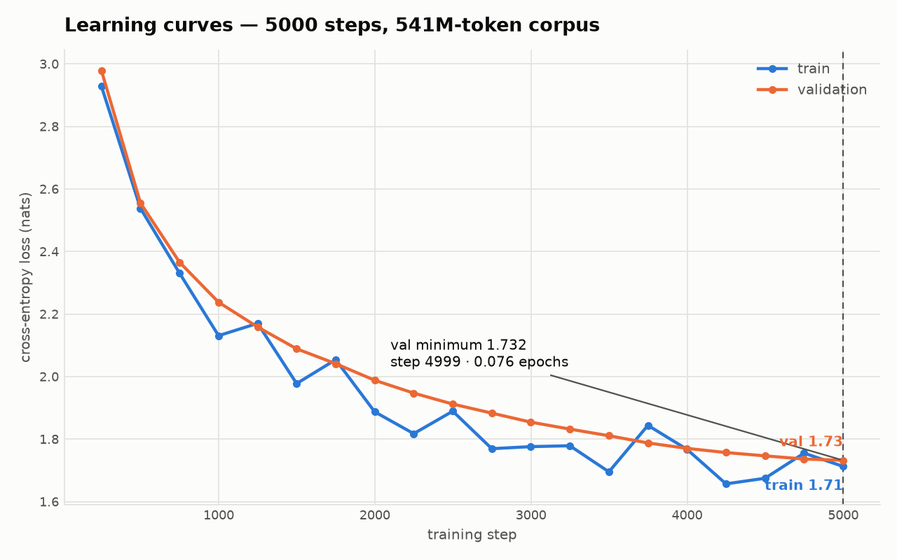

# Transformer from scratch

Building a Transformer language model from scratch, following Stanford CS336 (self-study). This repo tracks my progress.

The project follows Assignment 1 ("Basics") of the public Spring 2026 CS336 materials. It covers a
byte-level BPE tokenizer, every model layer, the optimizer and the training loop, all written in plain
PyTorch. No `torch.nn.Linear`, `nn.functional.scaled_dot_product_attention`, `torch.optim.AdamW`, or
tokenizer libraries are used. The model is trained on TinyStories on a laptop GPU (Apple `mps`).

## Progress

- [x] BPE tokenizer: byte-level BPE training (multiprocess pre-tokenization) plus encode / decode / streaming encode
- [x] Attention and multi-head attention: scaled dot-product attention, causal multi-head self-attention
- [x] RoPE, RMSNorm and SwiGLU
- [x] Transformer block and LM: pre-norm block, full decoder-only LM
- [x] Cross-entropy, AdamW and the LR schedule: numerically stable loss, AdamW, cosine schedule with warmup, gradient clipping
- [x] Training loop and checkpointing: memmap data loader, config-driven training script, checkpoint save/load
- [x] Decoding: temperature sampling from a prompt (`generate.py`)

Everything ticked passes the course unit tests (`uv run pytest`: 46 passed, 2 skipped; the skips are
Linux-only memory tests). The training loop has no unit test of its own; it was exercised by the
training runs below.

Learning log: [docs/LEARNING_NOTES.md](docs/LEARNING_NOTES.md) · scratch notebooks in [notebooks/](notebooks/) ·
experiments in [docs/EXPERIMENTS.md](docs/EXPERIMENTS.md) · what was tidied for publishing in [docs/CLEANUP.md](docs/CLEANUP.md)

## Architecture

A decoder-only, pre-norm Transformer (`cs336_basics/transformer_lm.py`, `transformer_block.py`):

```
token ids (B, T)
      │
      ▼
 Embedding  (vocab 10,000 → d_model 512)
      │
      ▼
┌──────────────── TransformerBlock × 4 ─────────────────┐
│                                                        │
│   x ──┬──► RMSNorm ──► causal multi-head attention ──►(+)──► x
│       │               16 heads × d_k 32            ▲   │
│       │               RoPE on Q and K (θ = 10,000) │   │
│       └────────────────────────────────────────────┘   │
│                                                        │
│   x ──┬──► RMSNorm ──► SwiGLU FFN ───────────────────►(+)──► x
│       │               W2 · (SiLU(W1 x) ⊙ W3 x)     ▲   │
│       │               d_ff 1344                    │   │
│       └────────────────────────────────────────────┘   │
└────────────────────────────────────────────────────────┘
      │
      ▼
 RMSNorm (final)
      │
      ▼
 Linear LM head (512 → 10,000, untied) → logits (B, T, 10,000)
```

| hyperparameter | value (`configs/base.yaml`) |
|---|---|
| vocab size | 10,000 (my BPE, incl. `<\|endoftext\|>`) |
| context length | 256 |
| d_model / layers / heads | 512 / 4 / 16 |
| d_ff (SwiGLU) | 1344 (≈ 8/3 · d_model) |
| RoPE θ | 10,000 |
| parameters | 22,696,448 (12.46M in blocks + 5.12M embedding + 5.12M LM head) |
| optimizer | AdamW, β = (0.9, 0.95), weight decay 0.1 |
| LR schedule | warmup 200 steps → cosine from 1e-3 to 1e-4 at step 5000 |
| batch | 32 × 256 tokens, gradient clipping at L2 norm 1.0 |

Config switches for ablations: `no_rmsnorm`, `post_norm`, `no_rope` (NoPE), `silu` (ungated FFN).

## Results

Dataset: **TinyStoriesV2-GPT4**, tokenized with my own BPE (vocab 10k) into 541M train / 5.5M
validation tokens.

**Final validation loss: 1.732** after 5000 steps (41M tokens, 0.076 epochs, 34 min at ~19.8k tok/s on
Apple `mps`, fp32). The train loss on the last batch was 1.713.



Sample from the 5000-step checkpoint (prompt "Once upon a time", temperature 0.8, 100 tokens in total;
from `notebooks/train_together.ipynb`, stops at the token limit):

> Once upon a time, there was a little boy named Tim. Tim was very adventurous. He loved to play outside
> and explore. One day, he went to the park with his mom and dad. He saw a big tree and wanted to climb it.
> Under the tree, Tim found a lot of color to put. He saw a girl named Sue playing with a ball. Tim asked
> Sue, "Can I play with your ball?" Sue said, "Yes, but be careful. It might

## Notes: what was tricky, what I learned

More detail in [docs/LEARNING_NOTES.md](docs/LEARNING_NOTES.md).

**BPE training (`train_bpe.py`).** Recounting every pair after every merge is too slow, so I update the
counts incrementally. My first version patched the neighbours left and right of each merge and needed
many special cases. The version I kept takes, for each changed word, the pairs after the merge minus
the pairs before it. I checked it against a brute-force recount on toy cases such as `(a, a)` merges
over `"lll"` and two words collapsing into the same new word. One early bug: ties were broken by
comparing token *ids* rather than their *bytes*. Special tokens are split out first, so they never take
part in a merge. Chunk boundaries for multiprocessing must be found in binary mode, because text-mode
`tell()` returns opaque cookies, not positions.

**Tokenizer encode (`train_bpe.py: Tokenizer`).** Merges are applied by rank within each pre-token,
with a cache from pre-token to merged result. The full corpus can't be encoded into a single Python
list: at ~36 bytes per int, 543M tokens is 18 GiB. So `encode_file_chunk` encodes chunk by chunk and
writes uint16 to disk.

**Attention (`multihead_self_attention.py`, `scaled_dot_product_attention.py`).** I build the causal
mask directly as a bool `triu` on the input's device. An earlier version allocated a full
`[batch, heads, seq, seq]` float tensor just to make the mask. I also switched `masked_fill_` (in place,
which can break autograd) to `masked_fill`. In the standalone attention function, the mask convention
is True = may attend, so the mask has to be inverted before filling with `-inf`.

**RoPE (`rope.py`).** In the notebook I first built the rotation as an explicit block-diagonal matrix.
The final version rotates each (even, odd) pair of features with precomputed `cos`/`sin` tables, then
interleaves them back. The tables are registered buffers, so they move with `model.to(device)` without
being trained.

**RMSNorm (`rmsnorm.py`).** Unlike LayerNorm there is no mean subtraction and no bias: each vector is
divided by its root-mean-square over `d_model` (with `eps` inside the square root) and scaled by a
learned gain. I upcast to float32 before squaring and cast back afterwards, because squaring and
averaging in low precision loses accuracy. The ablation shows how much the norm matters: without it,
training blew up (val loss ~7×10⁵ at the first eval).

**SwiGLU (`swiglu.py`).** The FFN is `W2(SiLU(W1 x) ⊙ W3 x)`: one branch is a SiLU-activated gate that
scales the other branch element-wise. With three matrices instead of two, `d_ff ≈ 8/3 · d_model`
(1344 for `d_model` 512, rounded to a multiple of 64) keeps the parameter count close to a classic
4× FFN. In my 2000-step ablation, plain SiLU was only 0.02 nats worse, too small to call with one seed.

**Softmax and cross-entropy (`softmax.py`, `cross_entropy.py`).** Softmax doesn't change if you subtract
the same constant from every logit, so I subtract the row max first: the largest exponent becomes
`exp(0) = 1` and nothing overflows (float32 `exp` overflows above ~88). Cross-entropy never forms
probabilities. It computes `logsumexp(logits) − logit[target]` with the same max trick, which avoids
`log(0)` when a probability underflows.

**Transformer LM (`transformer_lm.py`).** Two silent bugs. (1) The blocks were in a plain Python list,
so they were never registered: `.to()` skipped them and the optimizer never trained them. The fix was
`nn.ModuleList`. (2) The LM head had `in_features`/`out_features` swapped, and the tests never noticed
because they always pass weights in. Lesson: fixtures that supply weights never exercise the init path.

**Optimizer and schedule (`adamw.py`, `learning_rate_schedule.py`).** An optimizer is `defaults` (a
template), `param_groups` (the live hyperparameters) and `state` (keyed by parameter). To schedule the
LR, write `param_groups[i]["lr"]` before `step()`; changing `defaults` does nothing.

**Training loop (`train.py`, `data_loading.py`, `utils.py`).** The order is: zero_grad → backward →
clip → write lr → step. `np.memmap` means training RAM does not grow with dataset size. Evaluation uses
`torch.no_grad()` (3.02 GB → 1.02 GB for one forward) and a private, fixed-seed RNG, so every eval sees
the same batches and doesn't consume the training RNG. YAML 1.1 reads `1e-3` as a string, so configs
use `1.0e-3`. Run the script as a module (`python -m`), not by file path.

**Checkpointing (`checkpointing.py`).** Save the model, the optimizer state (Adam's m and v) and the step.
That makes a checkpoint 3× the weights (272 MB here), so save rarely.

## Experiments

Full write-up with tables: [docs/EXPERIMENTS.md](docs/EXPERIMENTS.md).

- **Data beats everything at first.** On a 243k-token slice, the model memorizes (train 0.44, val 4.25),
  and seven configs all bottom out within 0.08 nats of each other (val ≈ 3.25). With the full 541M-token
  corpus, the same model reaches 1.73.
- **Learning rate:** 1e-3 is best (val 1.988 at 2000 steps), 3e-3 is close (2.045), and 10× off in
  either direction costs 0.5–0.6 nats. AdamW never diverged to NaN, even at 300× the best LR with
  clipping off; it just stalls.
- **Batch size:** throughput is flat from batch 16 to 96 (~19–20k tok/s). Batch 128 ran out of memory
  (17.5 GiB peak on a 24 GB machine).
- **Ablations (2000 steps):** removing RMSNorm breaks training (val loss ~7×10⁵ at the first eval). NoPE +0.14,
  post-norm +0.05, SiLU vs SwiGLU +0.02 (the last two are too small to call with one seed).

## Next

- Post-training: RL fine-tuning with GRPO on GSM8K → [mbmbmmb/GRPO-GSM8K](https://github.com/mbmbmmb/GRPO-GSM8K)
- Decoding extras: top-p sampling, stopping at `<|endoftext|>`, and a KV cache for faster generation.
- Planned: CS336 Assignment 2 (systems): profiling, fused kernels, distributed training.

## How to run

Requires [uv](https://docs.astral.sh/uv/) and Python 3.12/3.13.

```sh
git clone https://github.com/mbmbmmb/Transformer-from-scratch.git
cd Transformer-from-scratch
uv run pytest                                    # unit tests

# data (TinyStories)
mkdir -p data/raw && cd data/raw
wget https://huggingface.co/datasets/roneneldan/TinyStories/resolve/main/TinyStoriesV2-GPT4-train.txt
wget https://huggingface.co/datasets/roneneldan/TinyStories/resolve/main/TinyStoriesV2-GPT4-valid.txt
cd ../..

# 1. train BPE (vocab 10k) and encode train/valid to uint16 .bin files
uv run python -m cs336_basics.train_bpe --config configs/bpe.yaml

# 2. train the LM (default device: mps; on NVIDIA add the cuda overrides)
uv run python -m cs336_basics.train --config configs/base.yaml \
    --override data.device=cuda training.device=cuda

# 3. sample (reads <logging.out_dir>/ckpt_4999.pt; train.py writes into <out_dir>/<run_name>/,
#    so point logging.out_dir at that run folder or move the checkpoint)
uv run python -m cs336_basics.generate --config configs/base.yaml --prompt "Once upon a time" --output_length 100

# ablation sweeps
bash scripts/sweep.sh            # learning rate + batch size
bash scripts/sweep_norm.sh       # no RMSNorm
bash scripts/sweep_postnorm.sh   # post-norm
bash scripts/sweep_nope.sh       # NoPE
bash scripts/sweep_silu.sh       # SiLU vs SwiGLU
```

## Layout

```
cs336_basics/
  train_bpe.py                  BPE training + Tokenizer (encode/decode) + CLI
  pretokenization.py            chunk boundaries for parallel pre-tokenization (course-provided)
  linear.py  embedding.py  rmsnorm.py  swiglu.py  rope.py  softmax.py
  scaled_dot_product_attention.py  multihead_self_attention.py
  transformer_block.py  transformer_lm.py
  cross_entropy.py  adamw.py  learning_rate_schedule.py  gradient_clipping.py
  data_loading.py  checkpointing.py  utils.py (config + overrides)
  train.py                      training script
  generate.py                   sampling
configs/    base.yaml (model + training), bpe.yaml (tokenizer)
scripts/    ablation sweeps
tests/      course unit tests; adapters.py wires them to this code
notebooks/  scratch notebooks from the learning process (kept as written)
docs/       EXPERIMENTS.md, LEARNING_NOTES.md, CLEANUP.md, figures/
```

The tests, the test fixtures and `pretokenization.py` come from the CS336 starter code
(MIT license, see `LICENSE`). Everything in `cs336_basics/` apart from `pretokenization.py` is my own
implementation.
