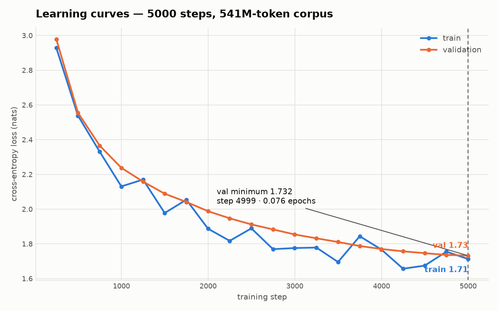
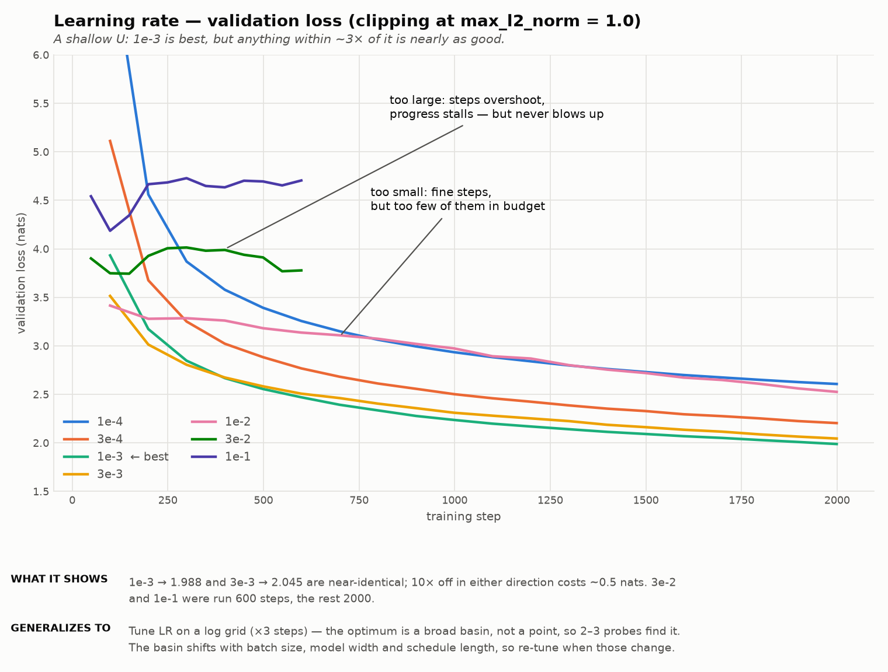
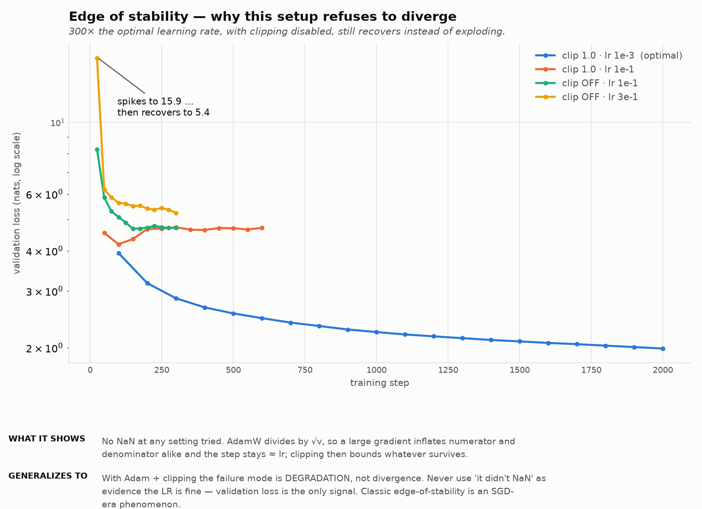
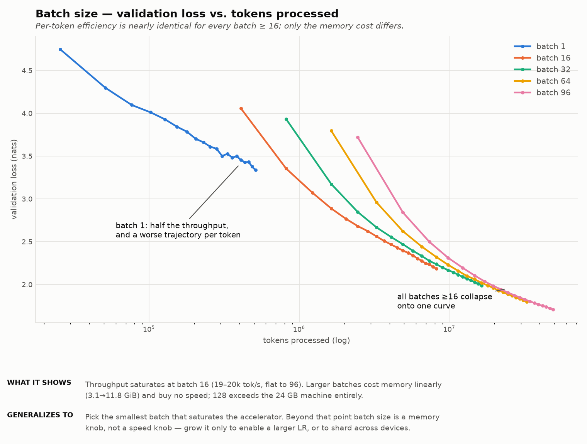
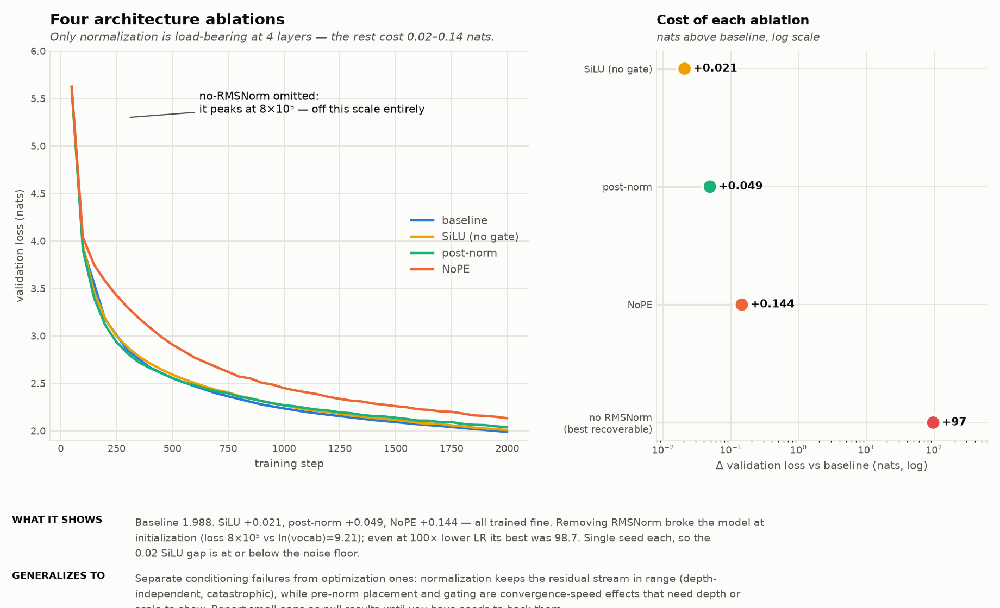

# Experiments

Every number below was read from the run logs (`metrics.jsonl`, one line per eval with
`t, train_loss, test_loss, lr, elapsed, tokens`), from `summary.md` and `NOTE.md` in the run folders, or
from the run config headers. The run folders themselves (`runs/`, ~262 MB with one checkpoint) are not
in this repo. `test_loss` in the logs is the **validation** loss.

- Hardware: Apple-silicon Mac, PyTorch `mps` backend, fp32, single device. NOTE.md gives the machine as
  ~24 GB of unified memory, shared with the OS.
- Loss is cross-entropy in nats per token. Validation loss is the mean over `eval_iters` fixed random
  batches (9 × 32 × 256 = 73,728 tokens for the base config). The same batches are used at every
  eval, so it estimates the full validation-set loss without computing it.
- "train" is the loss of the **single** training batch at that step, so it is noisy.
- Each configuration was run once with seed 0. No seed sweeps.

## 0. Model and data used throughout

| | |
|---|---|
| Dataset | TinyStoriesV2-GPT4 (train / valid text), tokenized with my own byte-level BPE |
| Vocab | 10,000 (incl. `<|endoftext|>`) |
| Train tokens | 541,229,347 (`train.bin`, uint16, 1,082,458,694 bytes) |
| Valid tokens | 5,465,883 (`valid.bin`) |
| Model | 4 layers, d_model 512, 16 heads (d_k 32), d_ff 1344 (SwiGLU), context 256, RoPE θ = 10,000 |
| Parameters | 22,696,448 (12.46M in the blocks, 5.12M embedding, 5.12M untied LM head) |
| Optimizer | AdamW, β = (0.9, 0.95), weight decay 0.1, eps 1e-8 |
| Schedule | linear warmup 200 steps → cosine to `min_lr` at step 5000 |
| Clipping | global L2 norm 1.0 |

## 1. Main run: full TinyStories, 5000 steps

Config: `configs/base.yaml` (batch 32 × 256 tokens, peak LR 1e-3, min LR 1e-4).

| step | tokens | train | val | lr |
|---:|---:|---:|---:|---:|
| 249 | 2.05M | 2.928 | 2.978 | 1.00e-3 |
| 999 | 8.19M | 2.131 | 2.238 | 9.40e-4 |
| 1999 | 16.4M | 1.887 | 1.988 | 7.22e-4 |
| 2999 | 24.6M | 1.776 | 1.854 | 4.34e-4 |
| 3999 | 32.8M | 1.767 | 1.770 | 1.93e-4 |
| **4999** | **41.0M** | **1.713** | **1.732** | 1.00e-4 |

- **Final validation loss 1.732** (also the lowest; it was still falling at the end).
- 2066 s (34.4 min) wall clock, about 19.8k tokens/s. 41M tokens = 0.076 epochs, so this run never
  repeats data and there is no overfitting gap.
- The handout's low-resource target was val ≤ 2.00 (from my notes). This run reaches it at about step 2000.

Other plots: [LR schedule](figures/base_lr_schedule.png),
[generalization gap](figures/base_generalization_gap.png), [val vs. epochs](figures/base_val_vs_epochs.png).

## 2. First attempt: a 243k-token corpus (overfitting)

Before encoding the full dataset, the first runs used a small encoded slice of TinyStories
(243,602 tokens, i.e. `487,204 bytes / 2`) with the same model and optimizer.

- Initial-test run (600 steps): val bottoms at **3.256 at step 249**. By step 599, train is **0.443** and
  val is **4.248**: the model memorizes the corpus.
- Seven 400-step ablations (from `summary.md`):

| run | best val | at step | final train | final val | tok/s |
|---|---|---|---|---|---|
| base (lr 1e-3, 4L, bs32) | 3.256 | 249 | 1.091 | 3.597 | 17,617 |
| lr 3e-4 | 3.287 | 374 | 2.358 | 3.288 | 18,094 |
| lr 3e-3 | 3.323 | 174 | 0.994 | 3.859 | 18,306 |
| 2 layers | 3.257 | 274 | 1.249 | 3.533 | 28,719 |
| 8 layers | 3.246 | 224 | 0.973 | 3.621 | 10,540 |
| batch 16 | 3.261 | 324 | 1.877 | 3.288 | 17,926 |
| batch 64 | 3.321 | 199 | 0.427 | 4.311 | 18,230 |

**Takeaway:** all seven best-val numbers fall within 0.077 nats (3.246–3.323). The amount of data set
the floor, not the architecture or the hyperparameters. The configs differ in *when* they reach it and
in how badly they overfit afterwards. Going from that floor (3.26) to 1.73 took 168× more distinct
tokens, with no model change.

Plots: [val curves](figures/small_corpus_val_curves.png), [best val](figures/small_corpus_best_val.png),
[throughput](figures/small_corpus_throughput.png), [learning curves](figures/small_corpus_learning_curves.png).

## 3. Sweeps on the full corpus (2000 steps each)

Scripts: `scripts/sweep*.sh`. Unless noted otherwise, each run is `base.yaml` with
`max_iters=2000`, so the baseline at 2000 steps is **val 1.988**.

> **Caveat for every 2000-step run:** `cosine_cycle_iters` stayed at 5000. The LR at the last step is
> therefore still 72% of peak (7.22e-4 for a 1e-3 peak); the cosine decay never finishes. All
> comparisons are at the same point of the same schedule, so they are fair to each other, but the
> absolute numbers are higher than a properly decayed 2000-step run would give.

### 3a. Learning rate (`scripts/sweep.sh`)

Each run scales `max_learning_rate` and `min_learning_rate` together (min = max / 10).

| peak LR | steps | final val | best val (step) |
|---:|---:|---:|---|
| 1e-4 | 2000 | 2.607 | 2.607 (1999) |
| 3e-4 | 2000 | 2.204 | 2.204 (1999) |
| **1e-3** | 2000 | **1.988** | 1.988 (1999) |
| 3e-3 | 2000 | 2.045 | 2.045 (1999) |
| 1e-2 | 2000 | 2.526 | 2.526 (1999) |
| 3e-2 | 600 | 3.778 | 3.744 (149) |
| 1e-1 | 600 | 4.705 | 4.186 (99) |

- 1e-3 is best, and 3e-3 is only +0.057 behind it. A 10× change in either direction costs 0.54–0.62 nats.
- The 3e-2 and 1e-1 runs (600 steps, eval every 50) are not in `sweep.sh`; they were launched by hand.
  Neither produced NaN or inf. Their loss stalls around 3.7–4.7 and drifts up after the first ~100–150 steps.

### 3b. Trying to make training diverge (clipping off)

Two runs at LR 1e-1 and 3e-1 with gradient clipping disabled. They ran 300 steps with an eval every
25 steps; how clipping was turned off is not recorded (no script):

| run | first eval (step 24) | final val (step 299) |
|---|---:|---:|
| no clip, lr 1e-1 | 8.240 | 4.709 |
| no clip, lr 3e-1 | 15.858 | 5.240 |

Even at 300× the best LR with no clipping, the loss spikes and then comes back down instead of going to
NaN. With AdamW, a too-large LR showed up as **slow, stalled progress, not divergence**.

### 3c. Batch size (`scripts/sweep.sh`, plus batch 96 run by hand)

Every run takes 2000 steps at LR 1e-3, so larger batches see proportionally more tokens.

| batch | tokens seen | final val | tok/s |
|---:|---:|---:|---:|
| 1 | 0.51M | 3.336 | 8,782 |
| 16 | 8.19M | 2.187 | 19,435 |
| 32 | 16.4M | 1.989 | 20,113 |
| 64 | 32.8M | 1.799 | 20,107 |
| 96 | 49.2M | 1.709 | 19,260 |
| 128 | — | OOM | — |

- **Same-token comparison** (val at exactly 8.19M tokens): batch 16 → 2.187, batch 32 → 2.237,
  batch 64 → 2.322. At 16.4M tokens: batch 32 → 1.989, batch 64 → 2.020. With this LR and schedule,
  a smaller batch is slightly more sample-efficient, while a larger batch wins per step.
- Throughput is flat from batch 16 to 96 (19–20k tok/s), so the GPU is already saturated at 16.
  Batch 1 gets less than half that.
- **Batch 128 ran out of memory.** NOTE.md: the OS killed the process after one eval. A 3-step probe
  measured a peak of 17.48 GiB, against ~24 GB shared with the OS. Batch 64 peaked at 10.15 GiB and
  completed, so the memory limit on this machine lies between 64 and 128.
- The batch-32 run and the LR-1e-3 run use the same config and seed. They end at 1.9888 and 1.9881,
  so run-to-run nondeterminism on `mps` is about 0.001 nats. This is not a seed-variance estimate.

### 3d. Architecture ablations (`sweep_norm.sh`, `sweep_postnorm.sh`, `sweep_nope.sh`, `sweep_silu.sh`)

Each run takes 2000 steps at LR 1e-3, eval every 50, and changes one thing relative to the pre-norm
RoPE SwiGLU baseline (val 1.988).

| variant | change | final val | Δ vs baseline |
|---|---|---:|---:|
| baseline | pre-norm, RoPE, SwiGLU (d_ff 1344) | 1.988 | — |
| SiLU FFN | `W2·SiLU(W1 x)`, no gate, d_ff 2048 to keep params ≈ equal (2.10M vs 2.06M per FFN) | 2.009 | +0.021 |
| post-norm | `norm(x + sublayer(x))` | 2.037 | +0.049 |
| post-norm, lr 3e-4 | same, lower LR | 2.174 | +0.186 |
| NoPE | no RoPE, so no positional information at all | 2.132 | +0.144 |
| no RMSNorm, lr 1e-3 | all 9 RMSNorms removed (600 steps) | 2168.7 | broken |
| no RMSNorm, lr 1e-4 | | 128.4 (best 98.67 @ 1949) | broken |
| no RMSNorm, lr 1e-5 | | 112,814 | broken |

- **No RMSNorm breaks the model from the start.** The first eval (step 49) already reads
  6.8e5–8.4e5 nats, whereas a well-initialized model starts near ln(10000) ≈ 9.21. Lowering the LR
  does not rescue it within 2000 steps. In this setup, the norms keep the residual stream and the
  logits in range.
- **NoPE** is the largest "working" loss (+0.144), mostly early on: at step 499 it is 2.910 vs 2.555.
  The causal mask still carries some order information, so the model trains, just more slowly.
- **Post-norm** (+0.049) and **SiLU vs SwiGLU** (+0.021) are small. With one seed, 2000 steps and
  4 layers, I would not claim either is a real effect without seed repeats. Post-norm at 3e-4 is worse than at 1e-3, so the post-norm gap does not come
  from 1e-3 being too high for it.

Per-ablation plots: [no RMSNorm](figures/ablation_layer_norm_ablation.png),
[post-norm](figures/ablation_pre_norm_ablation.png), [NoPE](figures/ablation_no_pos_emb.png).

## Summary of what is small and what is not

| effect | size | confidence |
|---|---|---|
| more distinct data (243k → 41M tokens) | 3.26 → 1.73 | large, clear |
| removing RMSNorm | model broken | large, clear |
| LR 10× off optimum | +0.54 to +0.62 | clear |
| NoPE | +0.14 | likely real |
| post-norm | +0.05 | small, single seed |
| SiLU vs SwiGLU (param-matched) | +0.02 | too small to call |
| batch size 16–64 at equal tokens | ≤ 0.14 | small, schedule-dependent |

## Gaps / things not run

- No seed repeats, so there are no error bars.
- The 2000-step sweeps did not shorten `cosine_cycle_iters` (see caveat above).
- The configs for the hand-run variants (batch 96, LR 3e-2 / 1e-1, no-clip runs) were not saved;
  only their logs exist.
- No OpenWebText training run. OWT BPE training ran out of memory in the notebook ("memory not enough").
